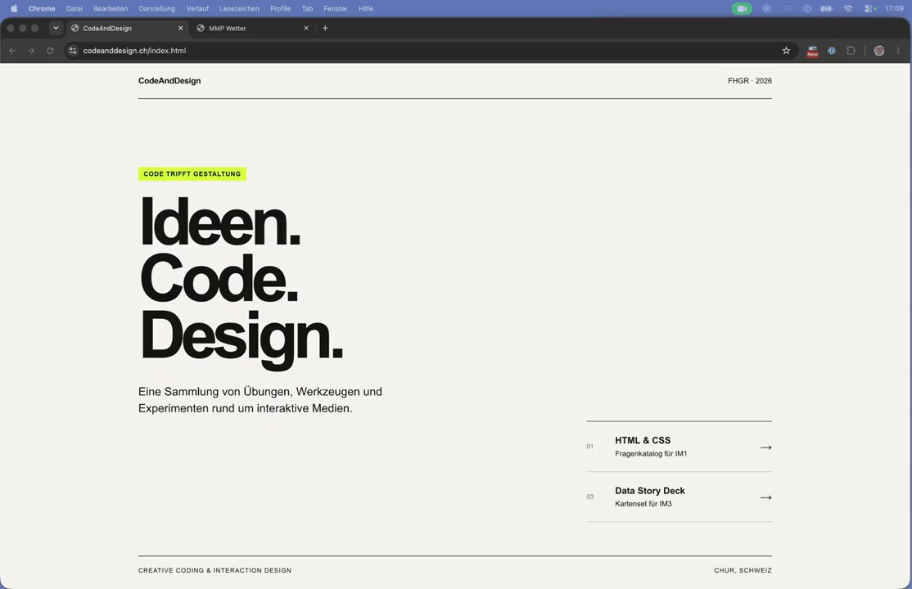
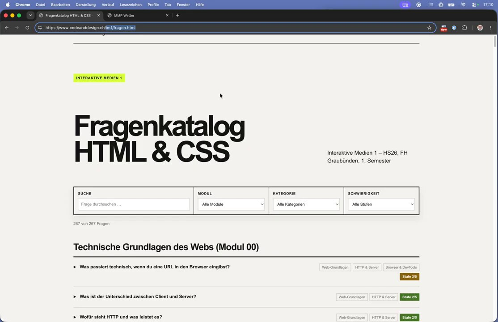
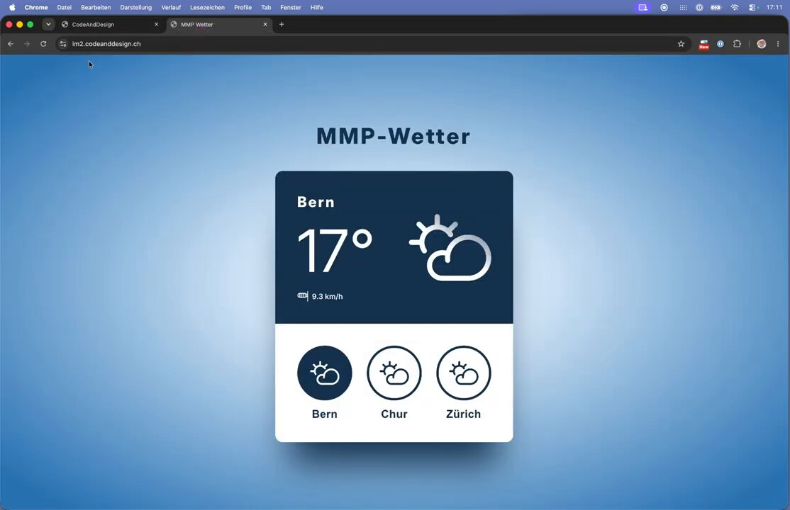
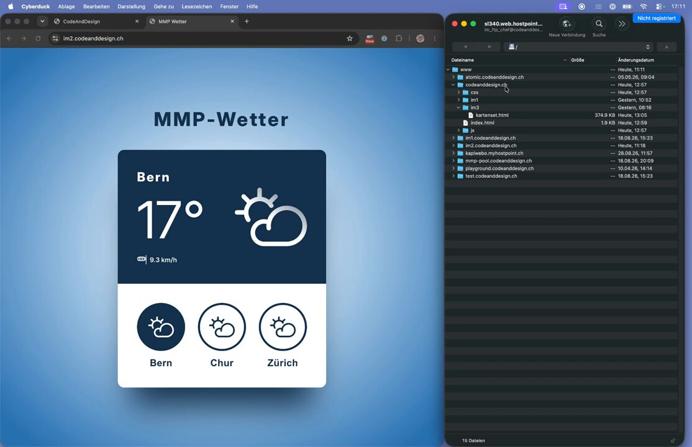
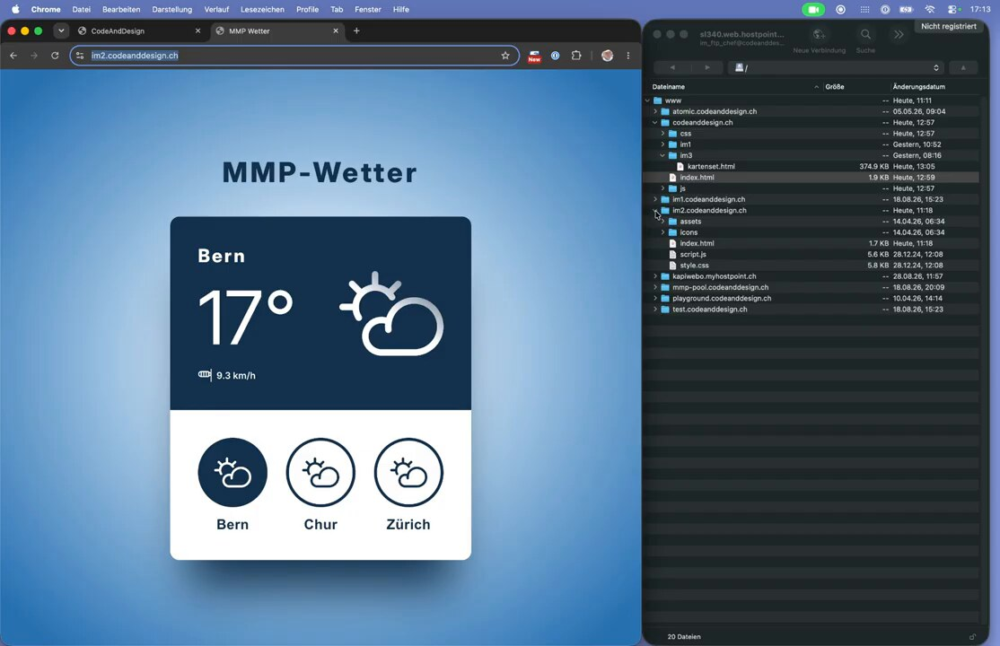

# Teil 1: Was ist eine Subdomain?

**Ziel:** Verstehen, wie sich eine Subdomain (z. B. `im2.codeanddesign.ch`) von einem Unterordner einer Domain (z. B. `codeanddesign.ch/im1/`) unterscheidet und wo die Dateien auf dem Server liegen.

---

## 1. Die Hauptdomain

Unter der Hauptdomain `codeanddesign.ch` liegt eine normale Website mit einer `index.html` als Startseite.



## 2. Variante A: Unterordner einer Domain

Ein Projekt kann einfach in einem **Unterordner** der Hauptdomain liegen. Die URL sieht dann so aus:

```
https://www.codeanddesign.ch/im1/fragen.html
```

Das Projekt teilt sich damit Ordner, Zugänge und Einstellungen mit der Hauptseite.



## 3. Variante B: Subdomain

Eine **Subdomain** ist ein eigener Name *vor* der Domain:

```
https://im2.codeanddesign.ch
```

Für den Browser ist das eine eigenständige Website mit eigenem Stammverzeichnis.



## 4. So sieht das auf dem Server aus

Im FTP-Programm (hier Cyberduck) sieht man im Ordner `www` für **jede Domain und jede Subdomain einen eigenen Ordner**:

```
www/
├── codeanddesign.ch/        ← Hauptdomain
│   ├── css/
│   ├── im1/                 ← Unterordner (Variante A)
│   ├── im3/
│   ├── js/
│   └── index.html
├── im1.codeanddesign.ch/    ← Subdomain
├── im2.codeanddesign.ch/    ← Subdomain (Variante B)
├── mmp-pool.codeanddesign.ch/
└── …
```



Öffnet man den Ordner `im2.codeanddesign.ch`, findet man genau die Dateien der Subdomain-Website (`index.html`, `script.js`, `style.css`, …).



---

## Merke

| | Unterordner | Subdomain |
|---|---|---|
| URL | `domain.ch/projekt/` | `projekt.domain.ch` |
| Ordner auf dem Server | `www/domain.ch/projekt/` | `www/projekt.domain.ch/` |
| Getrennt von der Hauptseite? | nein | ja, eigene Website |
| Eigener, eingeschränkter FTP-Zugang möglich? | umständlich | ja, einfach (→ Teil 3) |

**Warum Subdomains für den Workflow?** Jedes Projekt bekommt einen eigenen, abgeschotteten Bereich. In Teil 3 erstellen wir dafür einen FTP-Account, der *nur* diesen einen Ordner sieht. Geht etwas schief, ist nur dieses Projekt betroffen.

➡️ Weiter mit **Teil 2: Eine Subdomain auf Hostpoint erstellen**
