# Teil 2: Eine Subdomain auf Hostpoint erstellen

**Ziel:** Im Hostpoint Control Panel eine neue Subdomain (hier `im3.codeanddesign.ch`) als Website anlegen.

**Voraussetzung:** Ein Hostpoint-Webhosting mit einer eigenen Domain (hier `codeanddesign.ch` auf dem Hosting `kapiwebo`).

---

## 1. Control Panel öffnen

Unter [admin.hostpoint.ch](https://admin.hostpoint.ch) anmelden und unter **Services** das Webhosting anklicken (hier `kapiwebo`, *Standard Webhosting*).

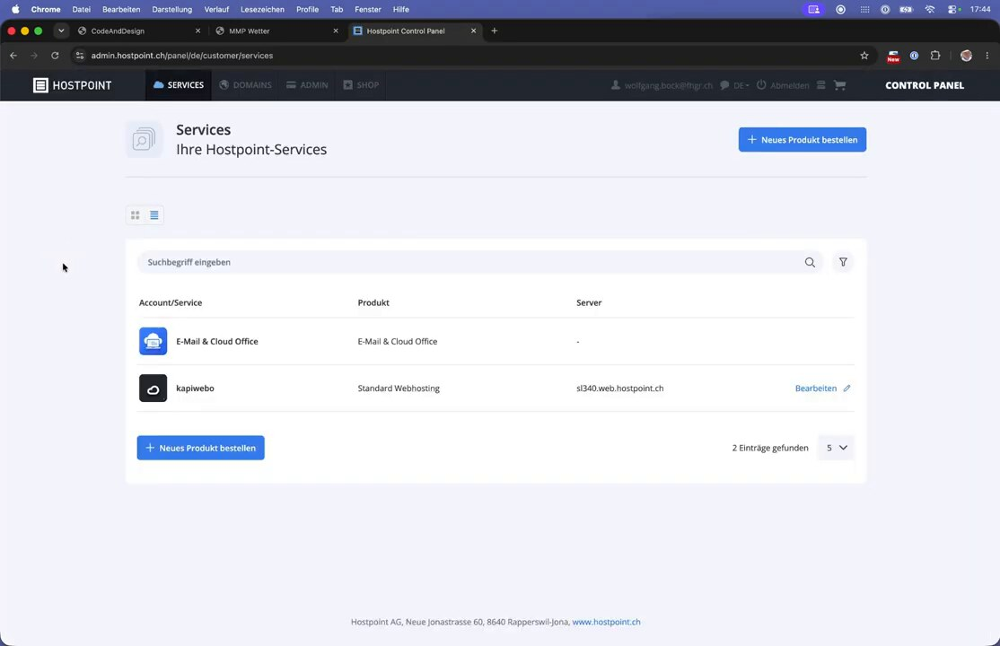

Es öffnet sich die **Server-Übersicht** mit Speicherplatz, Domains und Datenbanken. Links ist das Menü (E-Mail, Websites, Datenbanken, Explorer, Advanced, …).

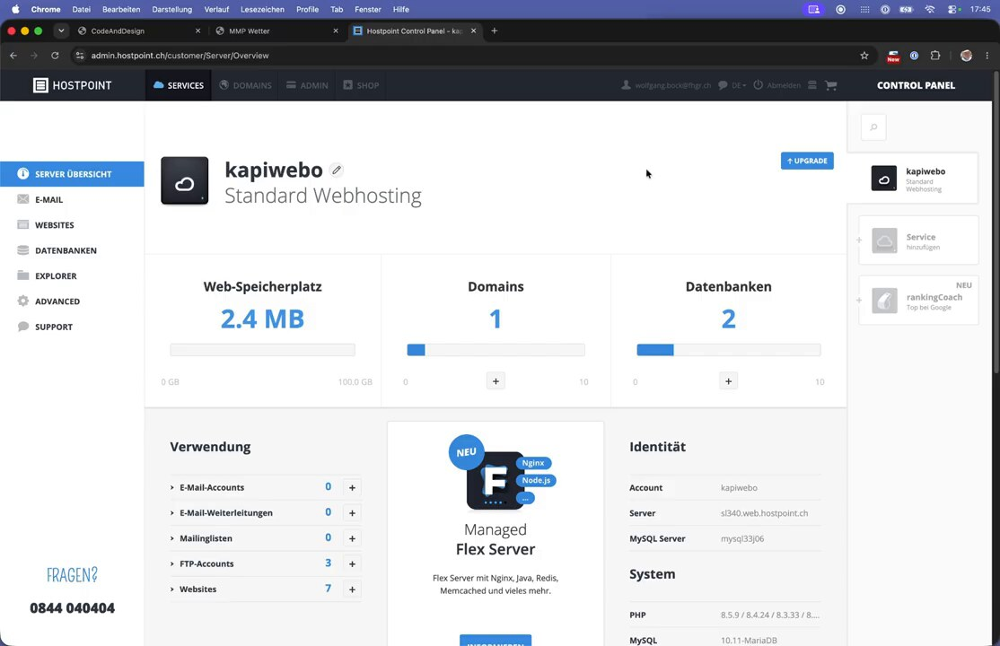

## 2. Kurzer Blick auf Domains und Ordner

Unter **Domains** findet ihr eure eigene(n) Domain(s).
Die Domain `abcdwxyz.myhostpoint.ch` wird euch von Hostpoint zur Verfügung gestellt. Eine eigene Domain, wie hier `codeanddesign.ch` könnt ihr zusätzlich kaufen (ca. CHF 12.- pro Jahr). Eine Subdomain muss man **nicht** kaufen, sie gehört automatisch zur Domain.

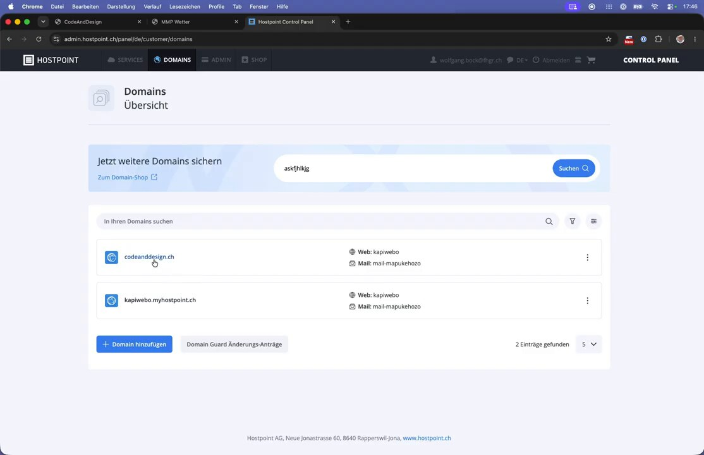

Im **Explorer** sieht man den Ordner `~/www` mit einem Unterordner pro Website, genau wie in Teil 1 erklärt.

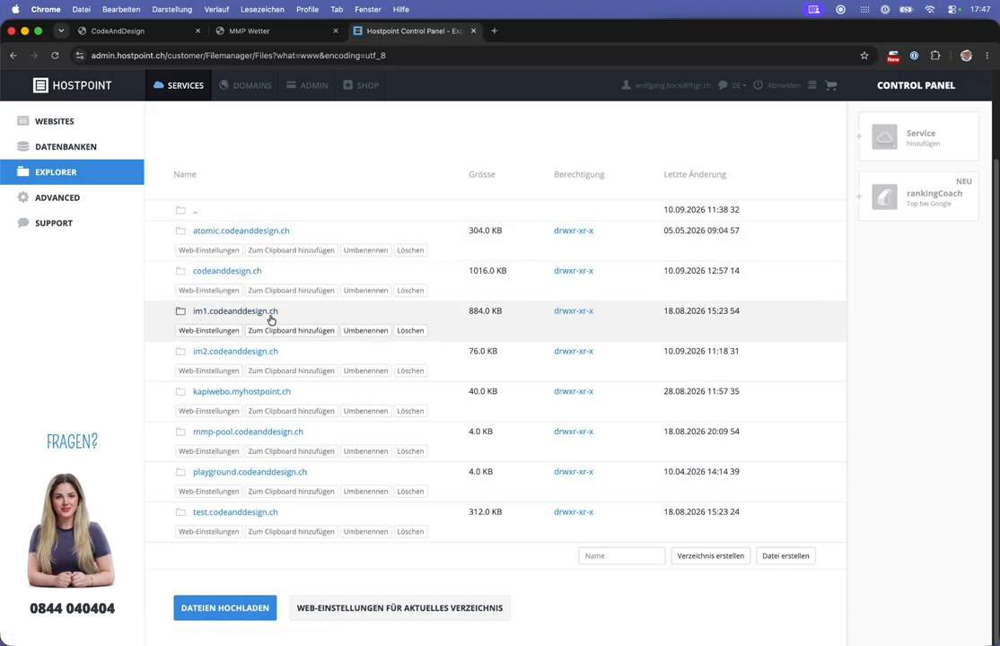

## 3. Neue Website erstellen

1. Links **Websites** anklicken und **Website erstellen** wählen.

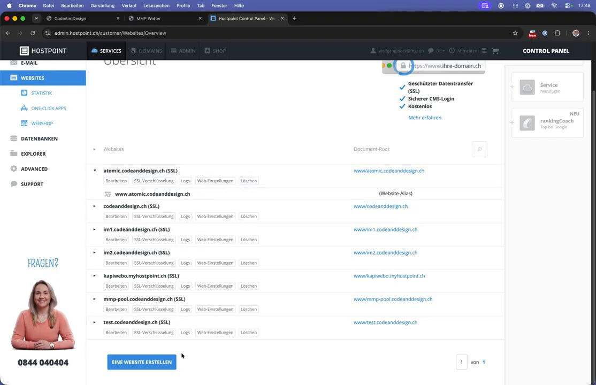

2. Bei **① Eine Domain auswählen oder eintippen** den gewünschten Subdomain-Namen eintippen, z. B. `im3.codeanddesign.ch`. Unter *Verfügbare Subdomains* erscheint der Vorschlag, diesen anklicken.

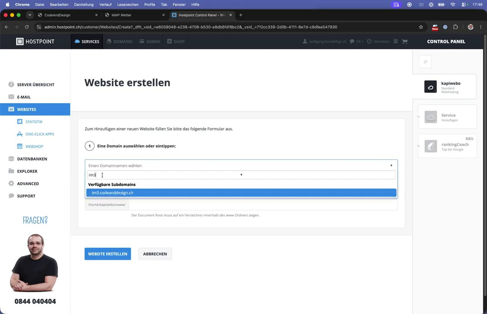

3. Bei **② In welchem Verzeichnis werden die Daten gespeichert?** wird automatisch `/home/kapiwebo/www/im3.codeanddesign.ch` vorgeschlagen. Diesen Vorschlag übernehmen.

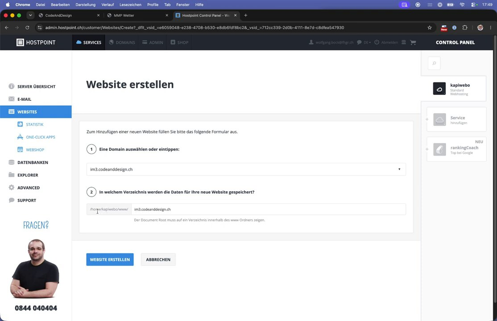

4. Auf **Website erstellen** klicken und kurz warten.

## 4. Bestätigung

Hostpoint meldet, dass die Website erstellt wurde, und aktiviert automatisch ein **kostenloses SSL-Zertifikat (FreeSSL)**. Die Seite ist damit später per `https://` erreichbar. Das kostenpflichtige Zertifikat-Angebot daneben braucht man nicht.

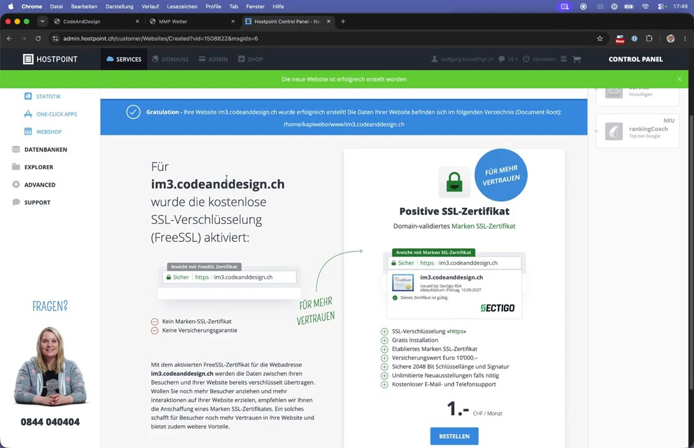

Im **Explorer** unter `~/www` gibt es jetzt den neuen, noch leeren Ordner `im3.codeanddesign.ch`.

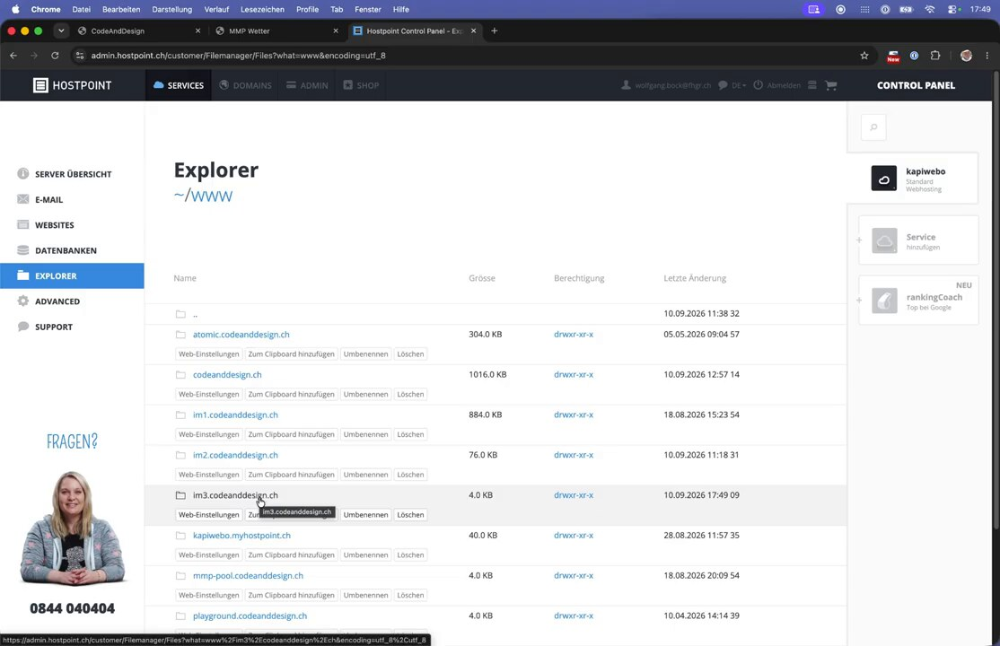

## 5. Testen: Fehlermeldungen sind hier normal

Ruft man `im3.codeanddesign.ch` direkt danach auf, erscheint zuerst ein **Konfigurationsfehler**: Die neue Subdomain ist noch nicht überall bekannt. Ein paar Minuten warten.

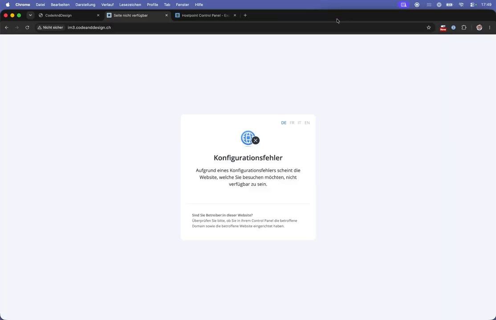

Etwas später kommt **Forbidden**. Das ist ein gutes Zeichen: Die Subdomain funktioniert, der Ordner ist aber noch leer (es gibt noch keine `index.html`).

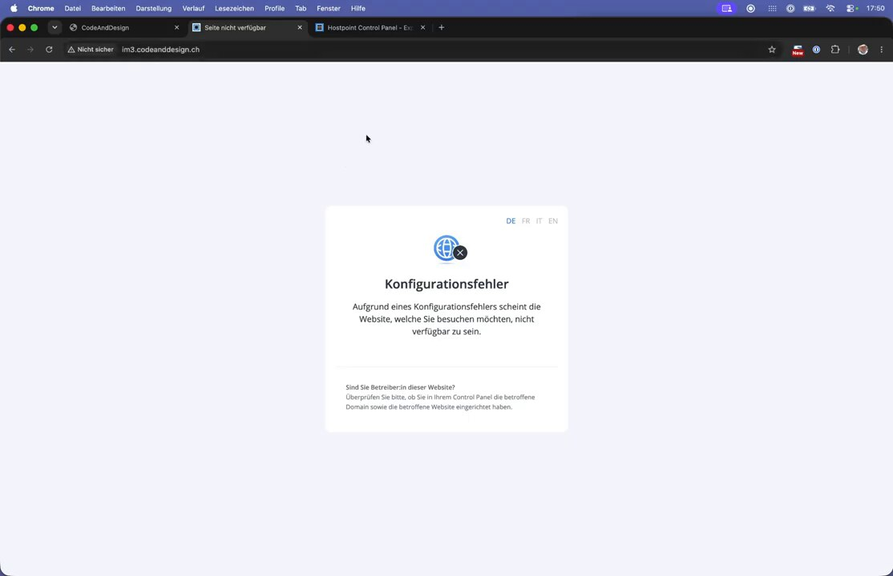

---

## Checkliste

- [ ] Website für die Subdomain im Control Panel unter *Websites* erstellt
- [ ] Verzeichnis `www/<subdomain>` vorhanden
- [ ] FreeSSL aktiviert
- [ ] Aufruf im Browser zeigt *Forbidden* (= bereit für Dateien)

➡️ Weiter mit **Teil 3: Einen FTP-Account für die Subdomain erstellen**
