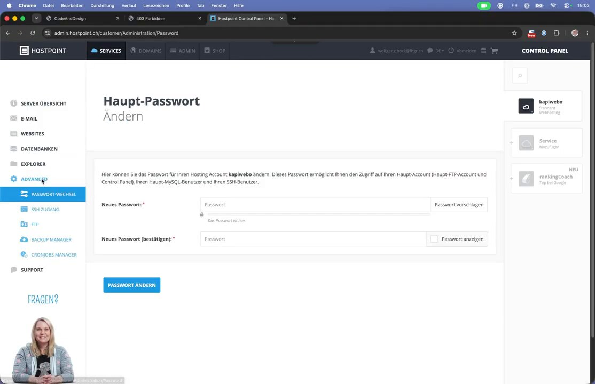
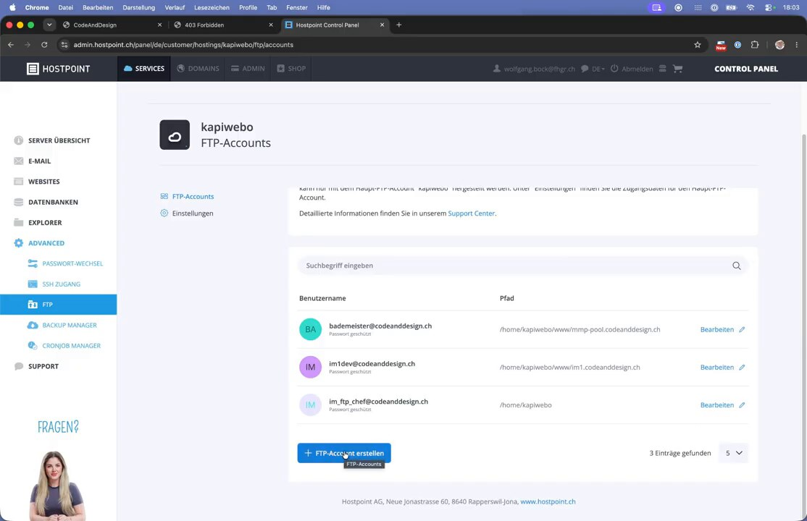
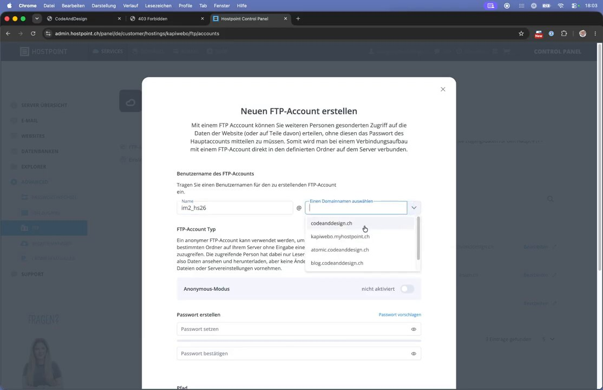
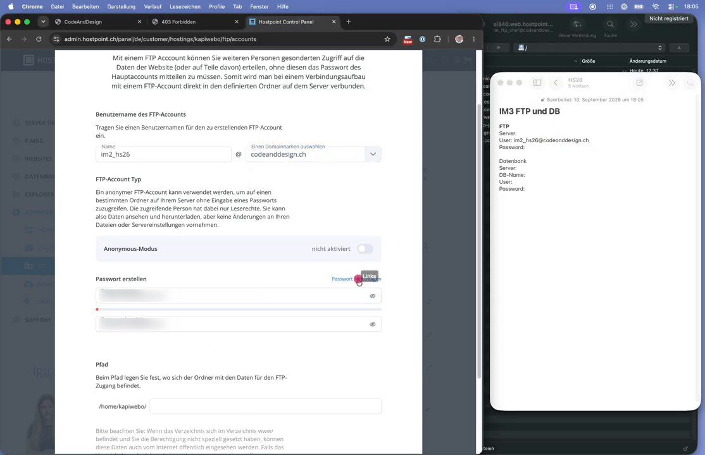
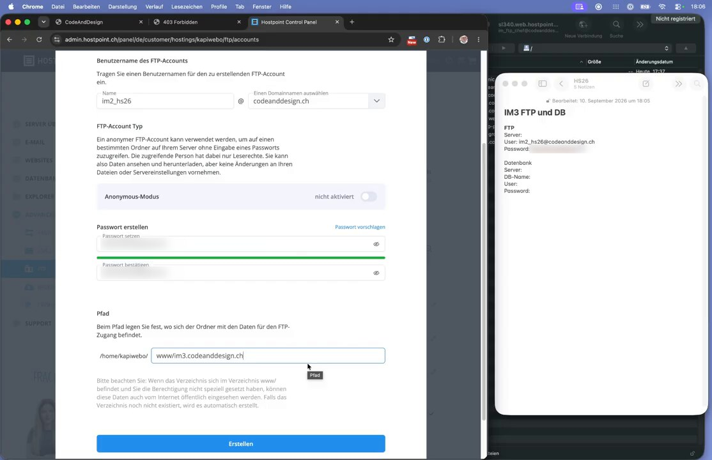
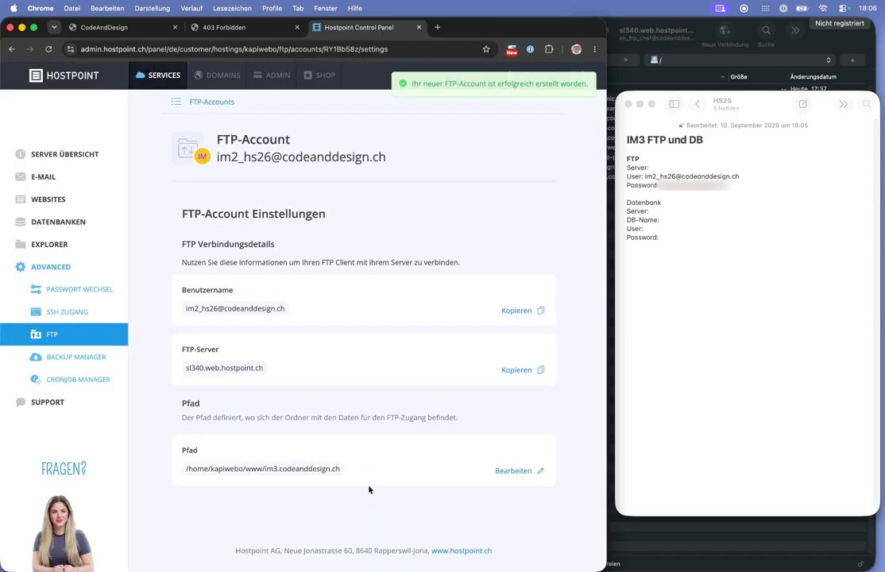
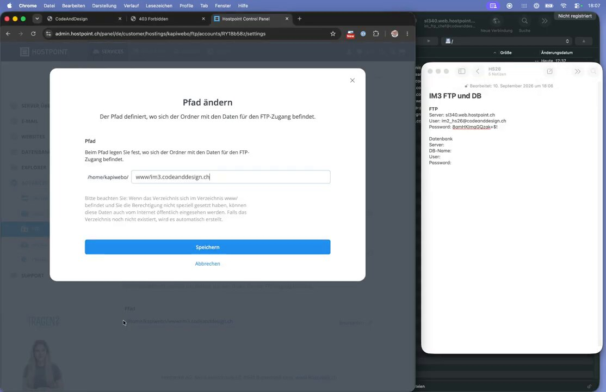

# Teil 3: Einen FTP-Account für die Subdomain erstellen

**Ziel:** Einen eigenen FTP-Zugang anlegen, der **nur** auf den Ordner der Subdomain zugreifen darf. Das ist der Kern des »abgesicherten« Workflows.

**Warum?** Der Haupt-FTP-Account (hier `im_ftp_chef`) hat Zugriff auf `/home/kapiwebo`, also auf *alle* Websites. Wird dieses Passwort in einem Tool gespeichert, geteilt oder geklaut, ist alles in Gefahr. Ein eigener Account pro Projekt begrenzt den Schaden auf diesen einen Ordner.

---

## 1. FTP-Verwaltung öffnen

Im Control Panel links **Advanced → FTP** anklicken. Die Liste zeigt die vorhandenen FTP-Accounts und ihre **Pfade**:

- `im_ftp_chef@…` → `/home/kapiwebo` (alles, *nicht* für Projekte verwenden)
- `im1dev@…` → `/home/kapiwebo/www/im1.codeanddesign.ch` (nur ein Projekt)



Unten auf **+ FTP-Account erstellen** klicken.



## 2. Benutzername festlegen

Einen sprechenden **Namen** eintippen (z. B. `im2_hs26`) und rechts die **Domain** wählen (`codeanddesign.ch`). Der vollständige Benutzername lautet dann `im2_hs26@codeanddesign.ch`.

Den **Anonymous-Modus** ausgeschaltet lassen.



## 3. Sicheres Passwort erstellen

Auf **Passwort vorschlagen** klicken. Hostpoint erzeugt ein starkes Passwort und trägt es in beide Felder ein (grüner Balken = stark).

> 🔐 **Zugangsdaten sofort sicher notieren**, z. B. in einer gesperrten Notiz oder einem Passwort-Manager:
> Server, Benutzername, Passwort.



## 4. Pfad auf den Subdomain-Ordner beschränken

Unter **Pfad** hinter `/home/kapiwebo/` den Ordner der Subdomain eintragen:

```
www/im3.codeanddesign.ch
```

Damit sieht dieser FTP-Account **nur** diesen Ordner. Existiert der Ordner noch nicht, legt Hostpoint ihn automatisch an.

Dann auf **Erstellen** klicken.



## 5. Verbindungsdetails notieren

Nach dem Erstellen zeigt Hostpoint die **FTP-Verbindungsdetails**. Diese braucht man in Teil 5 für PhpStorm:

| Feld | Wert (Beispiel) |
|---|---|
| Benutzername | `im2_hs26@codeanddesign.ch` |
| FTP-Server | `sl340.web.hostpoint.ch` |
| Pfad | `/home/kapiwebo/www/im3.codeanddesign.ch` |

Mit **Kopieren** lassen sich die Werte direkt in die Notiz übernehmen.



Den Pfad kann man später über **Bearbeiten** jederzeit ändern.



---

## Checkliste

- [ ] Eigener FTP-Account pro Projekt/Subdomain
- [ ] Starkes, generiertes Passwort, sicher gespeichert
- [ ] Pfad zeigt nur auf `www/<subdomain>`
- [ ] Benutzername, Server und Passwort notiert

➡️ Weiter mit **Teil 4: Ein Projekt in PhpStorm anlegen**
