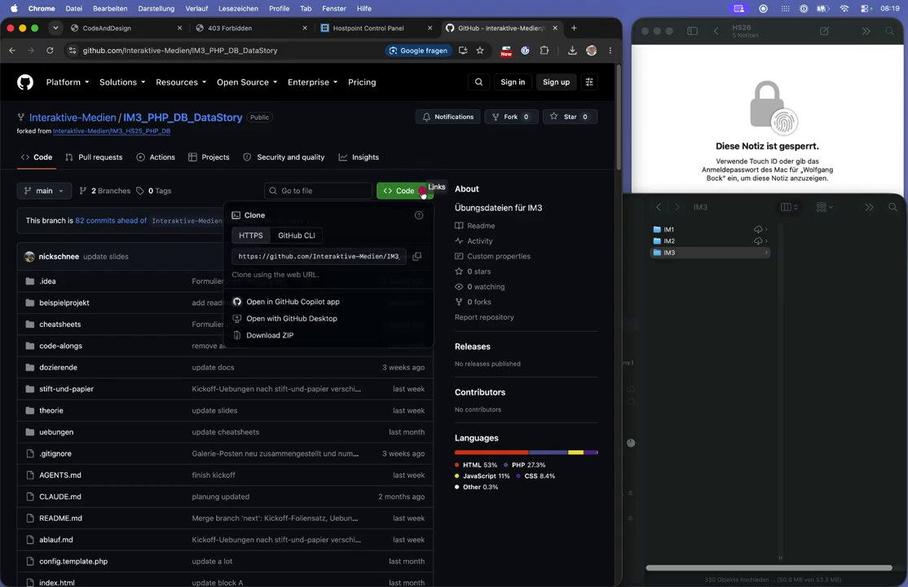
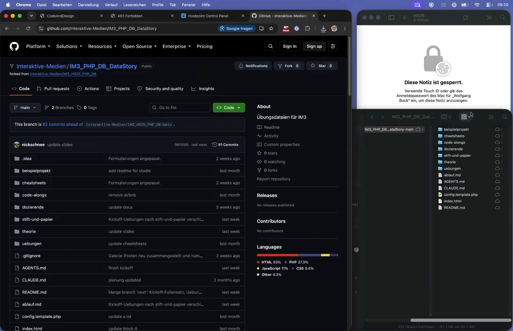
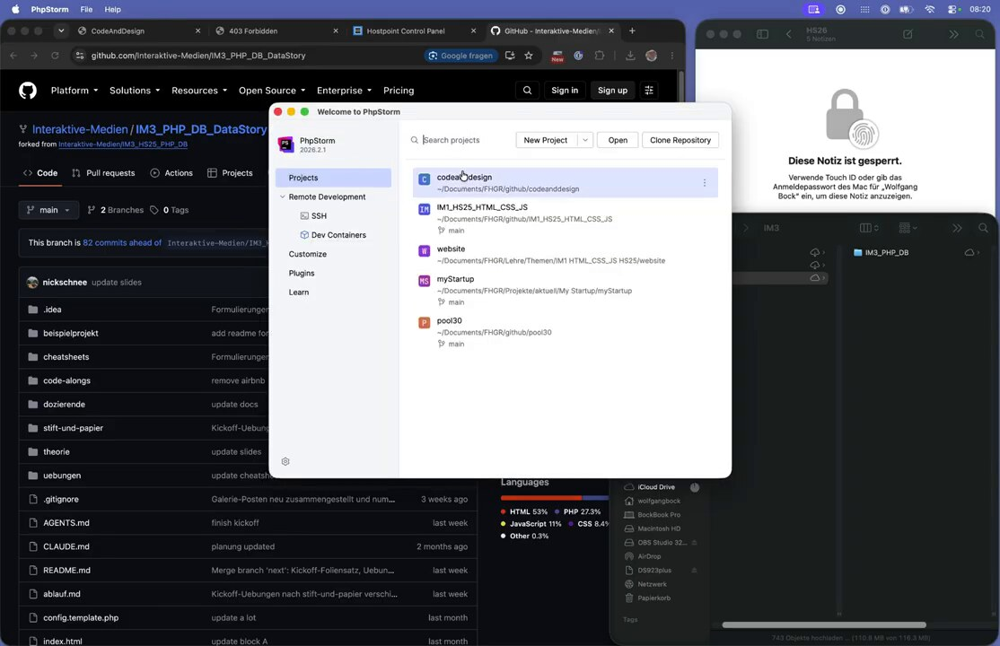
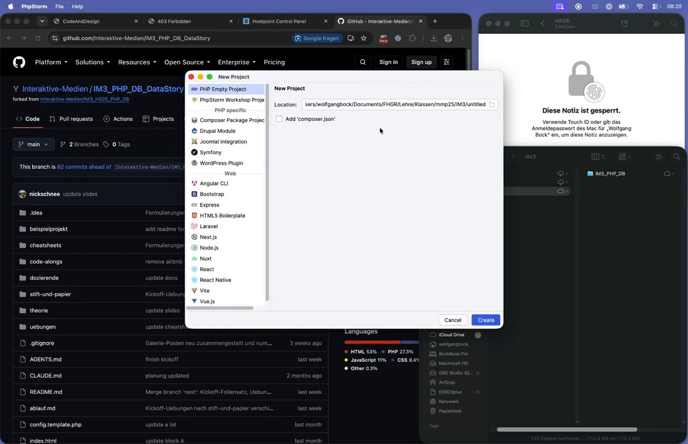
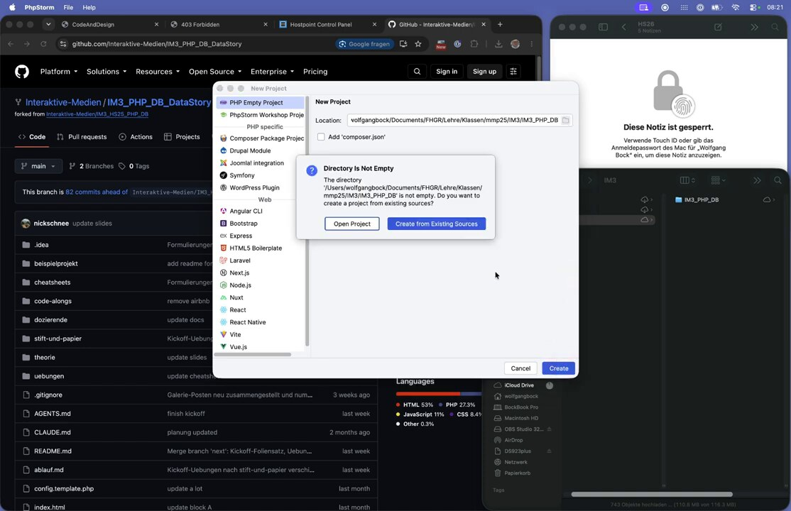
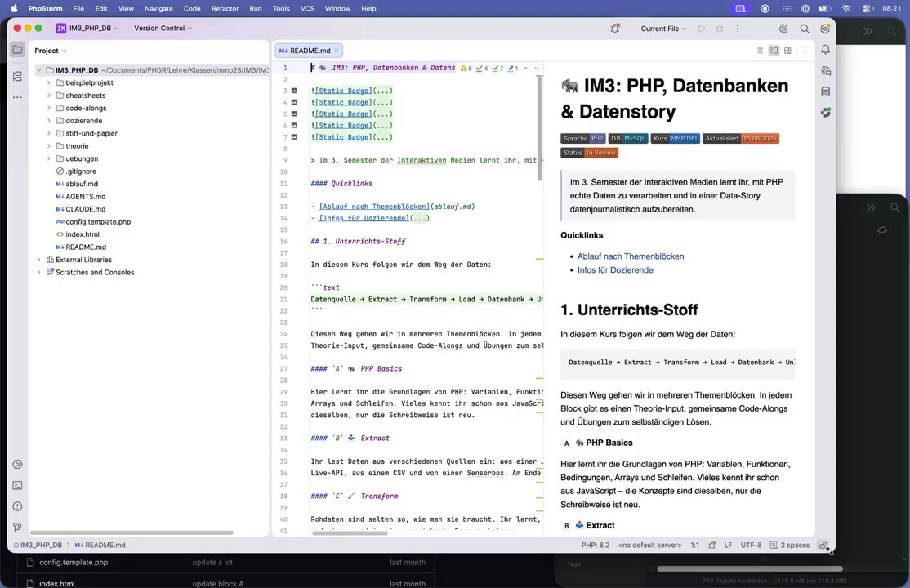
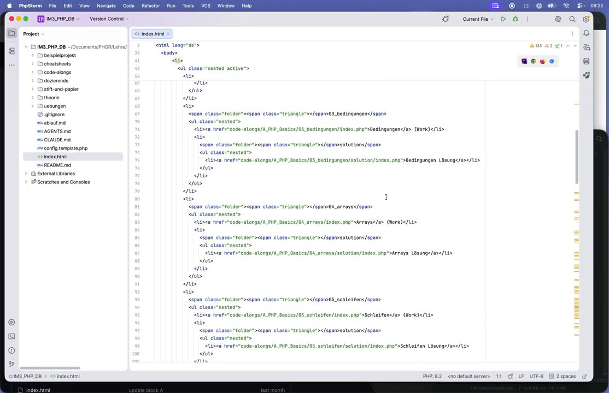

# Teil 4: Ein Projekt in PhpStorm anlegen

**Ziel:** Projektdateien lokal ablegen und in PhpStorm als Projekt öffnen. Als Beispiel dienen die Übungsdateien aus dem GitHub-Repository `Interaktive-Medien/IM3_PHP_DB_DataStory`.

---

## 1. Dateien von GitHub herunterladen

Auf der GitHub-Seite des Repositorys auf den grünen Button **<> Code** klicken und **Download ZIP** wählen.

## 2. Ordner entpacken und ablegen

Die ZIP-Datei entpacken und den Ordner an einen festen Ort verschieben, z. B. in einen Kursordner `…/IM3/`.

Tipp: Den Ordner kurz und ohne Sonderzeichen benennen, z. B. `IM3_PHP_DB` statt `IM3_PHP_DB_DataStory-main`.

## 3. PhpStorm starten

PhpStorm öffnen. Im **Welcome to PhpStorm**-Fenster auf **New Project** klicken.

## 4. Neues Projekt am Ort des Ordners anlegen

1. Links **PHP Empty Project** wählen.
2. Bei **Location** über das Ordner-Symbol den eben abgelegten Projektordner auswählen (z. B. `…/IM3/IM3_PHP_DB`).
3. *Add 'composer.json'* nicht anhaken.
4. Auf **Create** klicken.

## 5. Vorhandene Dateien übernehmen

Da der Ordner schon Dateien enthält, fragt PhpStorm nach: **Directory Is Not Empty**.
Hier **Create from Existing Sources** wählen, damit PhpStorm die vorhandenen Dateien als Projekt übernimmt.

## 6. Projekt ist bereit

Links im Bereich **Project** sieht man jetzt alle Ordner und Dateien (`beispielprojekt`, `code-alongs`, `uebungen`, `index.html`, `README.md`, …). Ein Doppelklick öffnet eine Datei im Editor. Bei Markdown-Dateien zeigt PhpStorm rechts eine Vorschau.

---

## Checkliste

- [ ] Projektordner lokal an festem Ort abgelegt
- [ ] In PhpStorm als *PHP Empty Project* mit *Create from Existing Sources* geöffnet
- [ ] Dateien im Project-Bereich sichtbar

> 💡 Wer Git kennt, kann statt *Download ZIP* auch **Clone Repository** im Willkommensfenster verwenden. Dann bleibt die Verbindung zu GitHub erhalten.

➡️ Weiter mit **Teil 5: Das Projekt per FTP mit der Subdomain verbinden**
