# Teil 5: Das Projekt per FTP mit der Subdomain verbinden

**Ziel:** PhpStorm so einrichten, dass Dateien direkt aus der IDE auf die Subdomain hochgeladen werden, auf Wunsch automatisch bei jedem Speichern.

**Benötigt:** Die Zugangsdaten aus Teil 3 (FTP-Server, Benutzername, Passwort) und das Projekt aus Teil 4.

---

## 1. Deployment-Konfiguration öffnen

In PhpStorm im Menü **Tools → Deployment → Configuration…** öffnen.

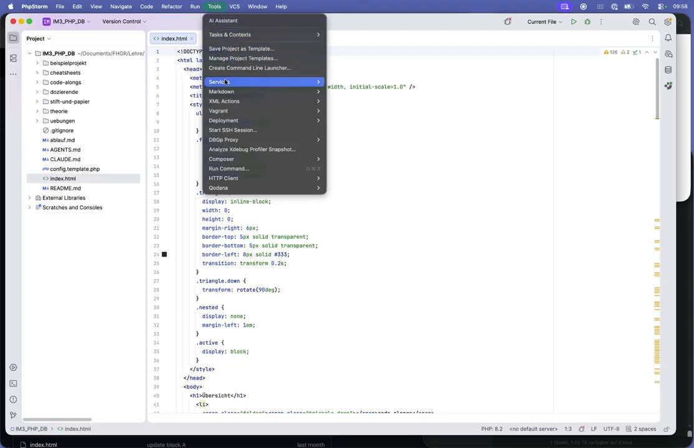

## 2. Neuen Server anlegen

Oben links auf **+** klicken, als Typ **FTP** wählen und einen Namen vergeben, z. B. `im3-Server`.

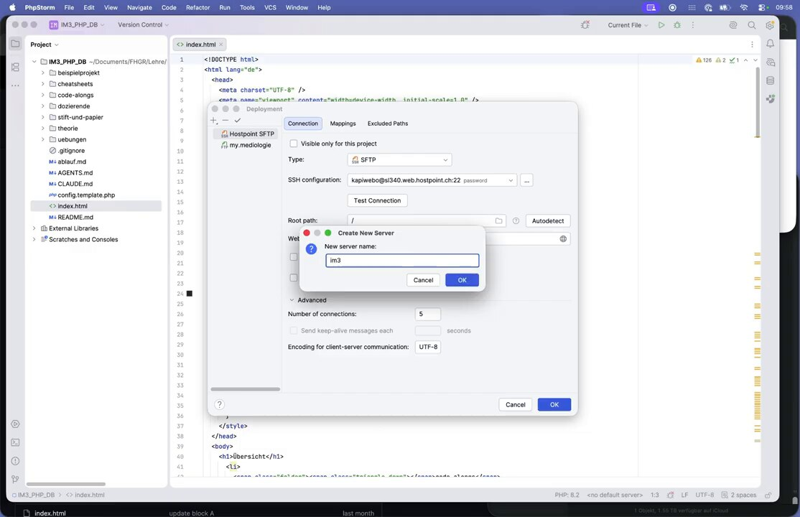

## 3. Verbindung eintragen (Tab »Connection«)

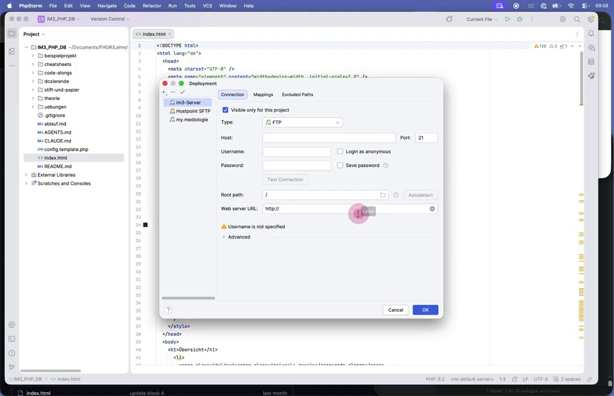

| Feld | Eintrag |
|---|---|
| Type | `FTP` |
| Host | `sl340.web.hostpoint.ch` (FTP-Server aus Teil 3) |
| Port | `21` |
| Username | `im2_hs26@codeanddesign.ch` |
| Password | Passwort aus Teil 3, **Save password** anhaken |
| Root path | `/` |
| Web server URL | `http://im3.codeanddesign.ch` |

**Visible only for this project** angehakt lassen. Dann ist der Server nur in diesem Projekt sichtbar.

**Root path `/`** genügt, weil der FTP-Account ohnehin nur den Subdomain-Ordner sieht (Teil 3).

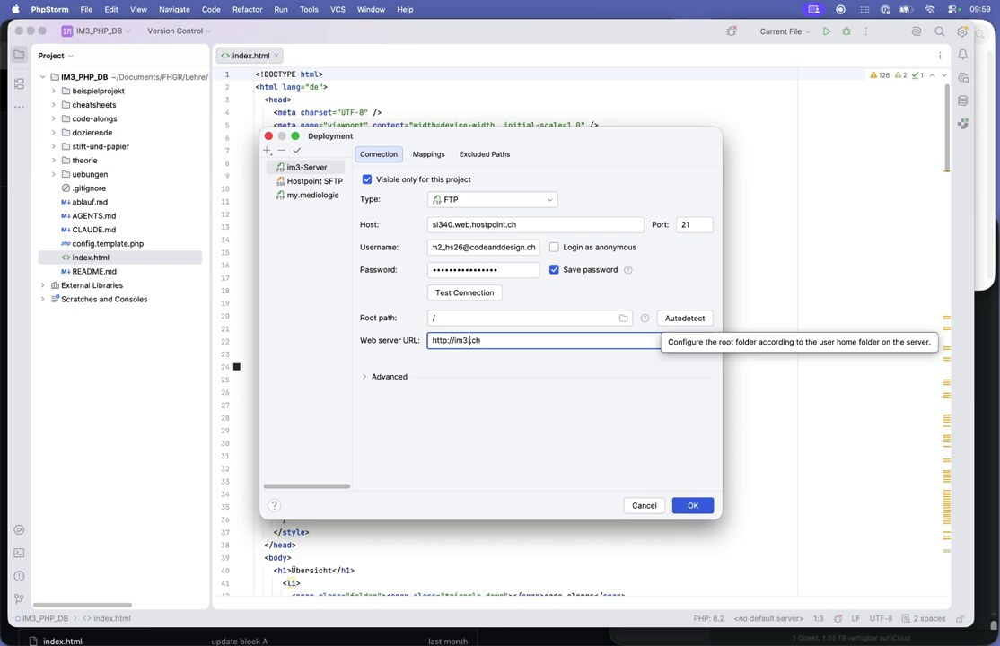

## 4. Verbindung testen

Auf **Test Connection** klicken. Erscheint *Successfully connected to sl340.web.hostpoint.ch*, stimmen die Zugangsdaten.

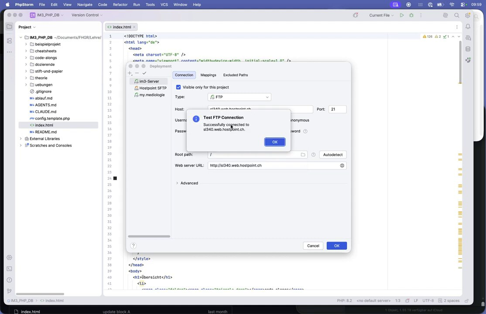

## 5. Ordner zuordnen (Tab »Mappings«)

Im Tab **Mappings** festlegen, welcher lokale Ordner wohin auf dem Server kommt:

| Feld | Eintrag |
|---|---|
| Local path | der Projektordner (wird automatisch eingetragen) |
| Deployment path | `/` |
| Web path | `/` |

Mit **OK** speichern.

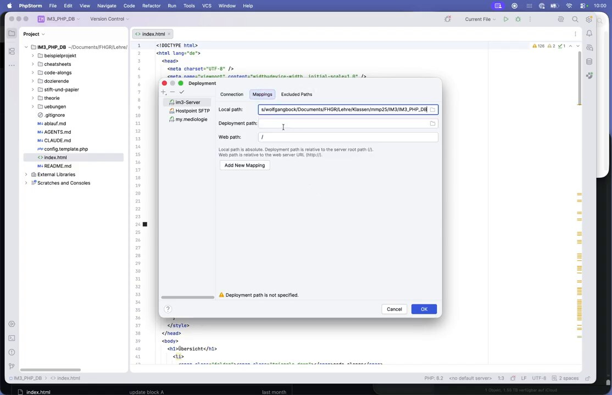

## 6. Server ansehen: Remote Host

Über **Tools → Deployment → Browse Remote Host** öffnet sich rechts das Fenster **Remote Host**. Dort sieht man den Inhalt des Servers. Am Anfang ist er noch leer.

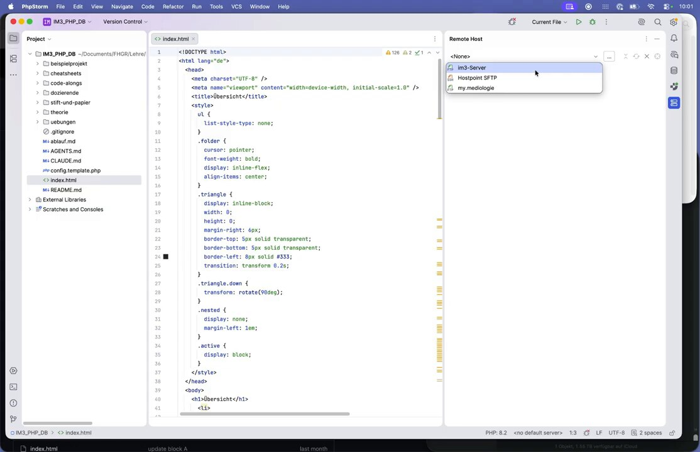

## 7. Datei manuell hochladen

Im Project-Bereich mit Rechtsklick auf die Datei (z. B. `index.html`) **Deployment → Upload to…** wählen und den Server `im3-Server` auswählen.

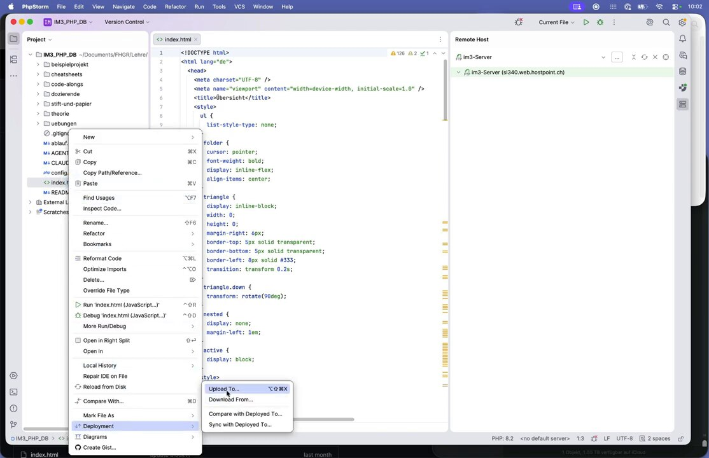

Die Sicherheitsabfrage **Confirm Uploading** mit **Yes** bestätigen.

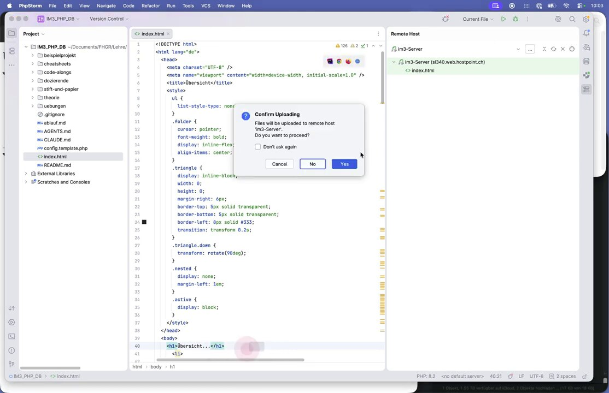

Die Datei erscheint im Remote-Host-Fenster. Im Browser zeigt `im3.codeanddesign.ch` jetzt die Seite statt *Forbidden*.

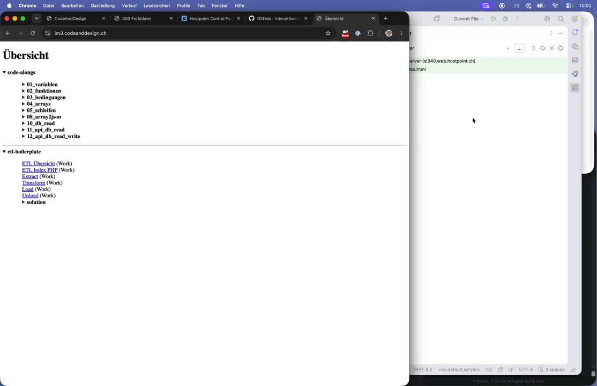

## 8. Automatischen Upload einschalten

Damit nicht jede Änderung von Hand hochgeladen werden muss:

1. **Tools → Deployment → Automatic Upload** anklicken.

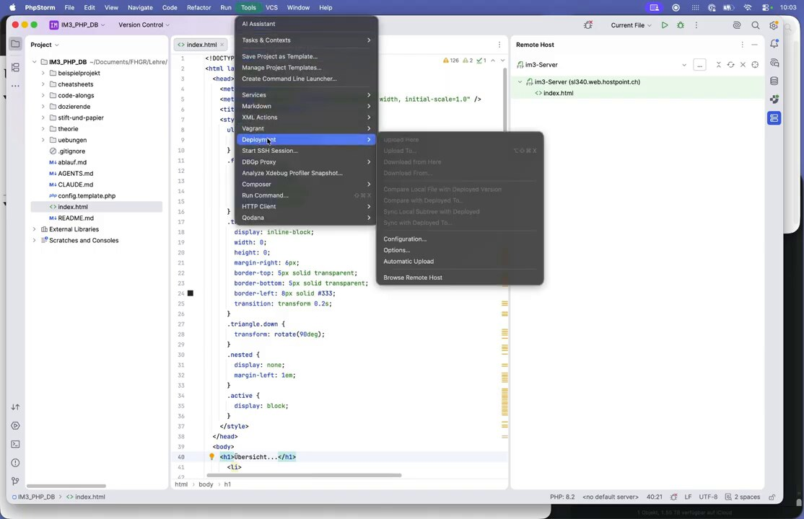

2. Bei **Choose Default Server…** den Server `im3-Server` wählen.

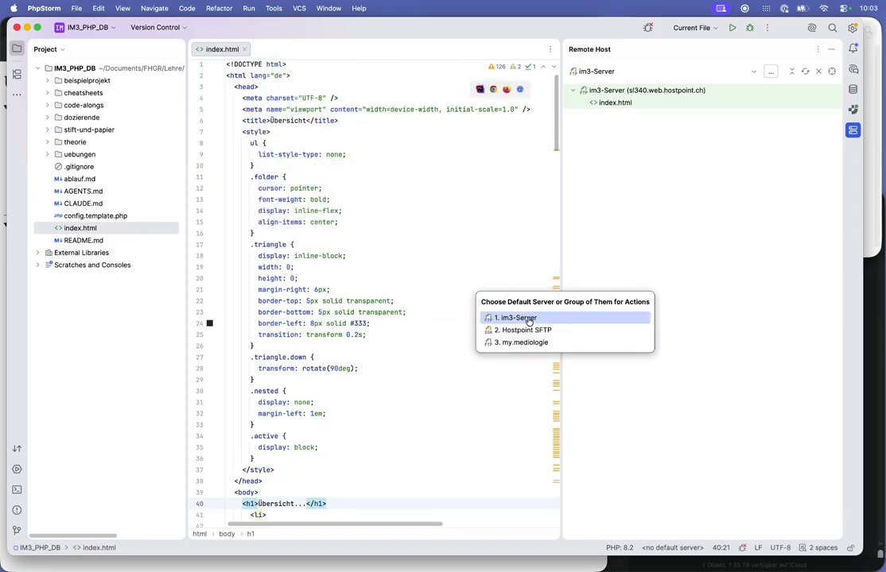

Unten in der Statusleiste steht nun `im3-Server` statt `<no default server>`. Ab jetzt wird jede gespeicherte Änderung automatisch hochgeladen. Zum Testen den `<h1>`-Text ändern und den Browser neu laden.

---

## Checkliste

- [ ] FTP-Server in PhpStorm mit dem **Subdomain-FTP-Account** (nicht dem Haupt-Account) eingerichtet
- [ ] *Test Connection* erfolgreich
- [ ] Mapping: lokaler Projektordner → `/`
- [ ] Datei hochgeladen, Seite im Browser sichtbar
- [ ] *Automatic Upload* mit Default-Server aktiv

> ⚠️ **Hinweis zur Sicherheit:** Normales FTP überträgt das Passwort unverschlüsselt. Hostpoint bietet auch **SFTP** an. Wo möglich, ist SFTP die sicherere Wahl (Type: SFTP, Port 22, siehe *Advanced → SSH-Zugang* im Control Panel).
>
> Der Workflow bleibt trotzdem »einigermaßen sicher«, weil ein FTP-Account immer nur ein einziges Projekt erreicht.
