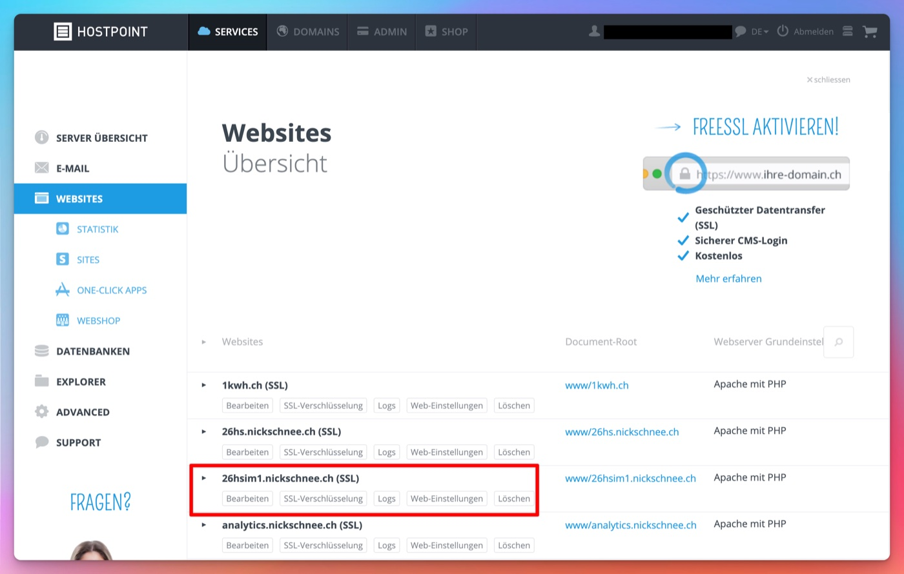
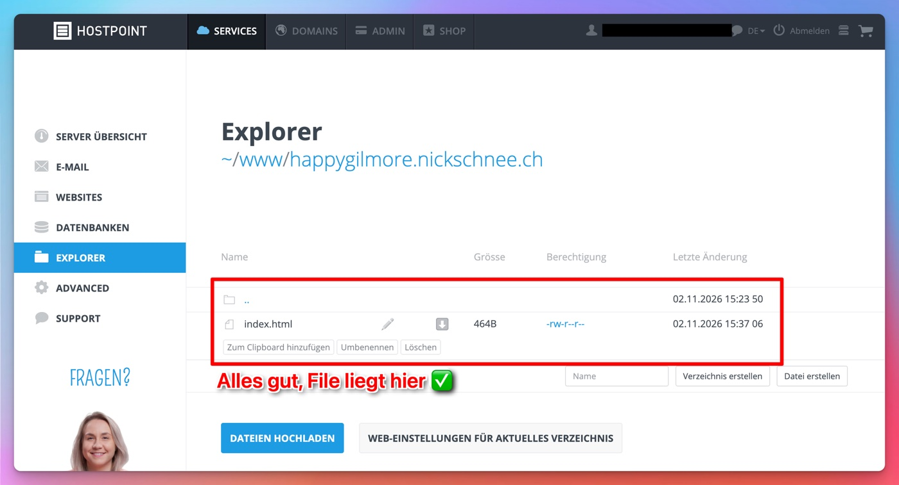
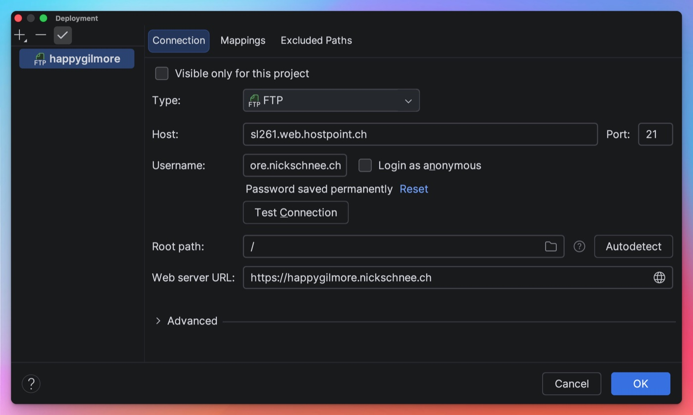

# Teil 6: Debugging

[← Übersicht](README.md) · Teil 6 von 6

**Ziel:** Wenn "etwas mit dem Deployment nicht funktioniert", Schritt für Schritt herausfinden, wo es hängt.

---

## Checkliste

Der Reihe nach abarbeiten. Beim ersten Punkt, der nicht stimmt, liegt der Fehler. Details stehen in den Abschnitten darunter.

- [ ] [Bin ich auf der richtigen Website?](#1-bin-ich-auf-der-richtigen-website)
- [ ] [Liegt die Datei auf dem Server?](#2-liegt-die-datei-auf-dem-server)
- [ ] [Stimmt die Deployment-Konfiguration in PhpStorm?](#3-stimmt-die-deployment-konfiguration-in-phpstorm)
- [ ] [Wird beim Speichern hochgeladen?](#4-wird-beim-speichern-hochgeladen)
- [ ] [Geht FTP immer noch nicht? Common Fixes](#5-geht-ftp-immer-noch-nicht-common-fixes)

---

## 1. Bin ich auf der richtigen Website?

**Symptom:** Meine Website bzw. meine neusten Änderungen werden nicht angezeigt.

1. In Hostpoint links in der Sidebar auf **Websites** klicken und prüfen, ob die Website existiert und richtig heisst.

   

2. Die URL der Website direkt aus dem Hostpoint-Panel kopieren und im Browser öffnen.
3. Im Browser prüfen, ob ich wirklich auf dieser Website bin oder ob sich ein **Tippfehler** in der URL eingeschlichen hat.
4. Ist die Website unter _Websites_ nicht aufgelistet: unten auf **Website erstellen** klicken (siehe [Teil 2](02_subdomain_auf_hostpoint_erstellen.md)).

✅ Alles ok? Weiter mit Schritt 2.

## 2. Liegt die Datei auf dem Server?

In Hostpoint unter **Explorer → www → _Name der Subdomain_** nachsehen, ob die Datei dort liegt.

- **Datei ist da**, aber die Website zeigt sie nicht → zurück zu Schritt 1 (falsche URL?).
- **Datei fehlt** → PhpStorm lädt nicht hoch. Weiter mit Schritt 3.

## 3. Stimmt die Deployment-Konfiguration in PhpStorm?

**Symptom:** PhpStorm hängt beim Deployment oder lädt nichts hoch.

In PhpStorm **Tools → Deployment → Configuration…** öffnen und die folgenden Punkte prüfen:

1. **Type:** `FTP` ist als Verbindungsart gewählt.
2. **Host:** stimmt mit den Angaben in Hostpoint überein.
   In Hostpoint unter **Advanced → FTP** auf den Account klicken. Achtung: Dort heisst das Feld **FTP-Server** (FTP-Server = Host).
3. **Username:** ist vollständig und korrekt, z. B. `nick@happygilmore.nickschnee.ch`
   - Der Teil nach dem `@` existiert und ist richtig geschrieben (so wie in Hostpoint angezeigt).
   - Der Username enthält **keine** Sonderzeichen (z. B. Punkte!), Leerzeichen oder Umlaute (ä, ö, ü).
4. **Web server URL:** ist **nicht** der Hostname, sondern die URL eurer Subdomain (am besten aus Hostpoint kopieren).
   Das ist kein Muss für den Upload. Ist sie falsch, öffnet aber _Rechtsklick → Open in Browser_ die falsche Domain.

Danach **Test Connection** klicken. Es muss _Successfully connected_ erscheinen.

## 4. Wird beim Speichern hochgeladen?

**Symptom:** Beim Speichern wird nichts hochgeladen.

1. Unter **Tools → Deployment** muss bei **Automatic Upload** ein Haken gesetzt sein, ebenso bei **Always**.
2. In PHPStorm prüfen, was tatsächlich hochgeladen wird: Links auf das Icon mit den **zwei Pfeilen** klicken. Es öffnet sich das Fenster **File Transfer**, das den Upload-Prozess anzeigt. Dort muss beim Speichern stehen, dass die Datei hochgeladen wurde.

## 5. Geht FTP immer noch nicht? Common Fixes

- **Neu aufsetzen:** Den FTP-Account in Hostpoint löschen und neu erstellen ([Teil 3](03_ftp_account_fuer_subdomain.md)). Dann die Konfiguration in PhpStorm ebenfalls löschen und neu abtippen ([Teil 5](05_projekt_per_ftp_verbinden.md)).
- **Netzwerk wechseln:** Auf einen Hotspot (z. B. vom Handy) wechseln. Manchmal wird das FHGR / BFH Netz blockiert, wenn zu viele User gleichzeitig drauf sind.

---

[⬅️ Teil 5: Das Projekt per FTP mit der Subdomain verbinden](05_projekt_per_ftp_verbinden.md) · [Übersicht](README.md)
